# Listener protocol V1

Wire version: **`ntapi.listener.v1`**. This is a proposed interoperability contract tested against a local reference service; hosted routes are not implemented or verified. Compatible implementations use these exact envelopes and semantics. Incompatible changes require a protocol revision. The built package exports schemas and types from `@nottherealapi/cli/protocol` and includes [JSON Schema 2020-12 definitions](protocol-v1.schema.json) and [wire examples](fixtures/v1.json). The schema's `$id` is an identifier, not a hosted API or a promise of a downloadable resource. Example IDs and claim tokens are synthetic; the placeholder signature is not cryptographically valid. Executable signed fixtures are generated by `test/fixture.mjs`.

All routes use POST and JSON; all successful responses are HTTP 200 JSON with a versioned envelope, including idle and close. Unknown fields are forbidden at every level. No compressed responses. Request headers: `Authorization: Bearer <scoped listener token>`, `Content-Type: application/json`, `Accept: application/json`, `X-NTAPI-Listener-Version: ntapi.listener.v1`. Every envelope also contains `version`; mismatch returns 409 `version_mismatch` and is terminal. No redirect handling or protocol fallback. Non-JSON and malformed/oversized envelopes terminate the run.

## Identity, scope and registration

Tokens have the type marker `ntapi_lst_` followed by 16–2048 ASCII URL-safe characters. The server validates the opaque token; the marker alone grants nothing. Grants bind workspace (derived server-side), environment (`preview` or `production`), installed module, destination digest, actions (`register`, `claim`, `ack`, `close`), absolute expiry and revocation. Every request checks the grant and an independent availability gate for its environment, including duplicate ACKs. Environment names are protocol scope values, not deployment addresses. Account-wide keys are not interchangeable. This protocol defines no token issuance, browser login or device authorization endpoint.

Destination is SHA-256 of the canonical WHATWG URL `href`, after replacing `localhost` with `127.0.0.1`, with default ports removed by URL parsing and the fixed path/query retained. Hash UTF-8 bytes to lowercase hex. Thus `http://localhost:3000/webhook` hashes exactly as `http://127.0.0.1:3000/webhook`. No full local URL is uploaded. A digest is not encryption; low-entropy destinations can be guessed. Grant issuers must bind the same digest to the approved route. The server cannot instruct the CLI to change its target.

| Route                                      | Request schema   | Response schema      |
| ------------------------------------------ | ---------------- | -------------------- |
| `/listener/v1/sessions`                    | `registerSchema` | `sessionSchema`      |
| `/listener/v1/sessions/{sessionId}/claims` | `pollSchema`     | `pollResponseSchema` |
| `/listener/v1/sessions/{sessionId}/acks`   | `ackSchema`      | `receiptSchema`      |
| `/listener/v1/sessions/{sessionId}/close`  | `closeSchema`    | `closedSchema`       |

Registration: `{version,sessionId,scope:{module,environment,destination}}`. The client generates a fresh random UUID per process/session. Response echoes the exact sessionId/scope plus UTC `expiresAt`. TTL is at most 300 seconds; the client allows one second of upper-bound clock skew and requires more than cloud deadline + local deadline + 2 seconds remaining. The reference service uses 300 seconds.

Only one active session owns a workspace/environment/module/destination scope; a different session ID returns 409 `session_conflict`. Same ID/scope registration is idempotent and **renews** expiry to now + TTL. This supports lost responses and renewal between claims without a dedicated heartbeat. Renewal cannot change an outstanding claim deadline/generation. A new process does not resume another process's session/ACK; wait for TTL, close or revocation. The client does not persist credentials or claims.

Close request `{version}` returns `{version,closed:true}`. Close revokes ownership and fences unacknowledged claims for bounded redelivery. It is idempotent under the same token for an already closed session; other ownership is 403/404. Auth revocation always wins over idempotency. The CLI best-effort closes an idle/finished session on exit with a one-second deadline. It does **not** close an unconfirmed claim; lease expiry controls recovery. At 256 acknowledged attempts it closes/rotates to bound its duplicate cache.

## Acquisition, fidelity and fencing

Poll `{version,waitMs}` holds outbound HTTPS for **0–10000 ms**. Cloud total deadline defaults to 15000 ms, capped at 30000. Idle response `{version,kind:"idle",retryAfterMs}` requires 250–30000 ms pacing; the client waits before polling again. The server must return within waitMs plus bounded serialization/network overhead. Session renewal happens between claims, without a separate heartbeat endpoint. Polling introduces request overhead, and idle pacing adds latency. Provider dispatch delay (`dispatchAt`) and polling latency are separate; the protocol provides no instant-delivery guarantee.

`claimSchema`:

| Field                     | Meaning / bound                                                     |
| ------------------------- | ------------------------------------------------------------------- |
| `sessionId`               | UUID owning the claim                                               |
| `deliveryId`, `attemptId` | Opaque transport identifiers, 1–128 `[A-Za-z0-9_-]`                 |
| `attempt`                 | 1–1,000,000; durable attempt number                                 |
| `eventId`                 | Provider event ID in the same safe ID alphabet                      |
| `eventType`               | 1–128 `[A-Za-z0-9_.-]`                                              |
| `claimToken`              | Secret lease capability; 16–256 URL-safe ASCII characters           |
| `generation`              | Positive safe-integer fencing generation                            |
| `dispatchAt`, `expiresAt` | UTC ISO timestamps; dispatch at most 1 second ahead of client clock |
| `bodyBase64`              | Canonical RFC 4648 standard alphabet/padding, no whitespace         |
| `bodySha256`              | SHA-256 of decoded bytes, lowercase hex                             |
| `bodyBytes`               | Decoded size 0–1,048,576; empty allowed                             |
| `headers`                 | At most 3 `[name,value]` pairs; rules below                         |

Lease is at most 120 seconds and no longer than session expiry. Before forwarding, at least **local deadline + 1000 ms** must remain; otherwise the CLI stops without executing/ACKing the invalid claim. Allocate at least 60 seconds for default settings. No claim renewal exists: local requests cap at 30 seconds. Enforce dispatch eligibility before issuance. Clock synchronization is a deployment prerequisite; wire deadlines are wall-clock times.

Server atomically claims a durable pending attempt with a new capability and monotonically increasing generation. Only one unacknowledged claim is outstanding per session; polling cannot bypass it. Fence old generations even if an old client later finishes. A lost claim response must not consume/acknowledge an attempt: recover through bounded expiry or offer the **identical** unacknowledged claim. A known attempt/generation reuses cached ACK without another local execution; reused attempt with changed generation in the same session is terminal. Redelivery gets a **new attempt ID**.

Decode Base64, verify canonical encoding/count/digest **before opening a local request**. Structurally valid claims with poisoned bytes/headers receive `invalid_payload` evidence without forwarding. Invalid envelope/version/size declarations terminate without ACK; server poison/retention policy must bound recurrence.

Provider names are case-insensitive ASCII. Exactly one each of `content-type` and `stripe-signature` is required; `stripe-account` is optional. Duplicate names, including alternate casing, are rejected, never comma-joined. Names max 64 and values max 8192 characters; values must be printable ASCII 0x20–0x7E. Signature values, including whitespace/commas, remain unchanged; transmitted name casing is lowercase. Another provider requires a reviewed protocol revision. Every unexpected header, including Host, Content-Length, Connection, cookies, authorization and listener metadata, is rejected. The CLI creates transport metadata and recomputes Content-Length. Response header parsing caps at 16 KiB.

## ACK evidence and receipts

ACK is `{version,sessionId,deliveryId,attemptId,claimToken,generation,ackKey,outcome}`. Random UUID `ackKey` is generated once after local outcome determination and reused with identical JSON on every retry. Atomically verify token/scope/gate, session ownership, capability, fencing, association and expiry, then durably record evidence. Changed content under the same key is 409 `stale_claim`. Exact duplicates return the original receipt even after claim expiry **while the token/session remains valid**. Preserve idempotency records for at least the session lifetime plus bounded retry/retention policy. An unrecorded ACK after lease expiry is 410 `claim_expired`.

Receipt `{version,ackKey,receipt:"recorded"}` confirms evidence persistence, not local success. Echoed key must match. Downloading or claiming is not acknowledgement. Never ACK before the receiver's full response is interpreted.

| `outcomeSchema` field             | Meaning                                                                     |
| --------------------------------- | --------------------------------------------------------------------------- |
| `classification`                  | `success`, `http_error`, `connection_error`, `uncertain`, `invalid_payload` |
| `status`                          | Observed local status 100–599 or null                                       |
| `durationMs`                      | Rounded elapsed local time, 0–120000                                        |
| `requestBytes`                    | Intended body size if transmitted, else 0; not proof of peer receipt        |
| `responseBytes`                   | Observed count capped at 65536; lower bound on abort/truncation             |
| `responseComplete`                | True only for complete HTTP framing                                         |
| `truncated`                       | True when response exceeds limit                                            |
| `error`                           | `none`, `timeout`, `aborted`, `socket`, `response_limit`, `validation`      |
| `responseHeaders`, `responseBody` | Always `[]` and `""` in V1                                                  |

All response content is omitted before uplink. Regex redaction cannot rigorously remove arbitrary secrets, so V1 sacrifices excerpts while retaining status/counts/timing. No raw bodies, signature/claim/auth tokens, full URLs or arbitrary remote error text appear in output/exceptions. No telemetry or payload-debug option.

`success` requires complete 2xx. Complete 3xx/4xx/5xx is `http_error`; no redirect following. Refusal/TLS failure before transmission is `connection_error`. Timeout/disconnect/cancel/overflow after transmission is **uncertain**, even with observed 2xx headers. `invalid_payload` means nothing was forwarded. Server evidence/retry policy must use local classification rather than its own ACK HTTP 200. Server must validate logical consistency too (a `success` with incomplete response is invalid); JSON schemas provide structural constraints.

## Recovery and lifecycle

```mermaid
stateDiagram-v2
  [*] --> disconnected
  disconnected --> authenticating
  authenticating --> listening: scoped session
  listening --> claimed: fenced lease
  claimed --> forwarding: bytes validated
  claimed --> ack_pending: invalid payload
  forwarding --> ack_pending: full response / failed / uncertain
  ack_pending --> acknowledged: recorded receipt
  acknowledged --> listening: continuous mode
  acknowledged --> failed: local failure
  acknowledged --> uncertain: local uncertainty
  failed --> listening
  uncertain --> listening
  authenticating --> backoff: retryable
  listening --> backoff: retryable
  ack_pending --> backoff: retain same ACK key
  backoff --> authenticating: register retry
  backoff --> listening: poll retry
  backoff --> ack_pending: retry before expiry
  listening --> authenticating: renewal / expiry
  forwarding --> shutdown: abort; preserve uncertain outcome
  ack_pending --> shutdown: rejection / expiry / cancel
  listening --> shutdown: auth / protocol / cancel
  shutdown --> [*]
```

`failed` and `uncertain` are logical outcome states in the `acknowledged` output's fields, not extra success events. One active claim/request, bounded buffers and a bounded ACK cache support long runs. Repeated identical claims reuse ACKs with 250 ms pacing and stop after eight consecutive duplicates to prevent a faulty server's busy loop. `ack_pending` emits sanitized evidence **before** uplink; `ack_unconfirmed` repeats essentials on reporting failure. There is no durable client outbox: redirect JSON output to a protected local file for crash-surviving local evidence. Never persist/replay lease capabilities across sessions.

| HTTP    | Error code(s)                                         | Behavior                                                                     |
| ------- | ----------------------------------------------------- | ---------------------------------------------------------------------------- |
| 401     | `unauthorized`                                        | Stop: token invalid/expired/revoked                                          |
| 403     | `forbidden`                                           | Stop: denied scope or disabled feature                                       |
| 404     | `not_found`                                           | Stop: route/session missing                                                  |
| 409     | `session_conflict`, `stale_claim`, `version_mismatch` | Stop: no session takeover/local replay                                       |
| 410     | `session_expired`                                     | Only from poll: fresh registration after 250 ms, max 8 consecutive refreshes |
| 410     | `claim_expired`                                       | Stop; preserve unconfirmed result                                            |
| 429     | `rate_limited`                                        | Retry with Retry-After and jitter                                            |
| 500–599 | `unavailable`                                         | Retry with backoff                                                           |

Errors are exactly `{version,code}` without text. Incompatible HTTP/code pairs are rejected. Network loss/timeouts retry; malformed content/version terminates. Eight retries per operation use equal jitter `[base/2,base]`, exponential base initially 500 ms capped at 30 seconds by default. Retry-After integer seconds or HTTP date overrides jitter to prevent early retries; >60 seconds stops this run. ACK retries also stop at lease expiry with the identical evidence/key. Ctrl+C/SIGTERM cancels requests/sleeps immediately; local abort preserves uncertainty and sends no false ACK. Cloud total deadline includes response body consumption. Local connection/header deadlines are separately 2/5 seconds, capped by total deadline.

Crash, lost claim response, expired lease, session restart or hosted deployment boundary may cause another local execution. ACK loss retries the same key until receipt/rejection/deadline; a restarted process cannot replay it. This is **at-least-once**, never exactly-once. Handler deduplication on provider event ID is required.

The service owns retention, retry limits, quotas, poison handling and terminal expiration, including offline listeners. The proposed V1 policy limits pending retention to 15 minutes from dispatch eligibility and delivery to 8 attempts. Polling and restarts do not extend retention, leases cannot exceed it, and terminal expiry retains an outcome record. These values describe the proposed contract, not verified hosted behavior. The CLI provides no global retention guarantee; the in-memory reference fixture is not durable storage.
